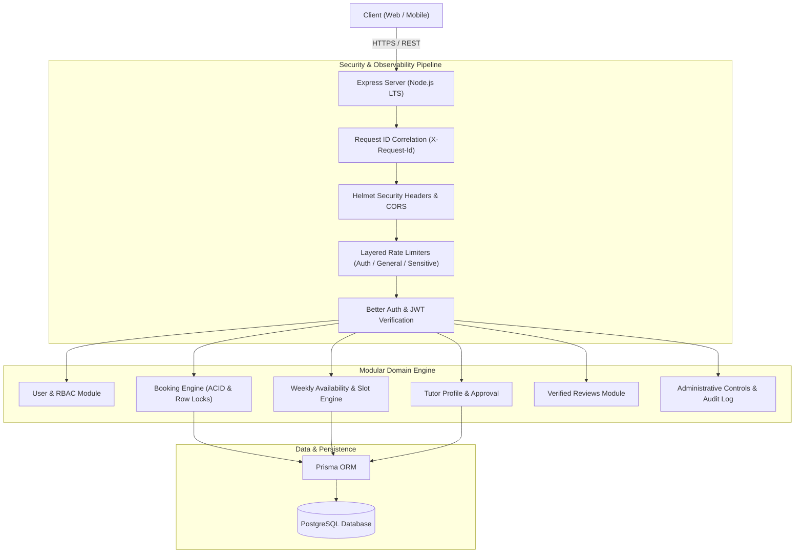

# ⚡ SkillBridge Backend

[](https://www.typescriptlang.org/)
[](https://nodejs.org/)
[](https://expressjs.com/)
[](https://www.postgresql.org/)
[](https://www.prisma.io/)
[](https://better-auth.com/)
[](https://jestjs.io/)
[](#)

---

## Overview

**SkillBridge** is a modern tutoring marketplace backend designed to eliminate scheduling conflicts, protect transactional integrity, and enforce strict role boundaries between **Students**, **Tutors**, and **Administrators**.

Built with **TypeScript** and **PostgreSQL**, the system serves as the definitive source of truth for tutor vetting, dynamic slot generation, atomic booking reservations, and immutable review tracking.

---

## System Architecture



---

## Key Engineering Highlights

### 1. Concurrency-Safe Booking Engine (Pessimistic Locking)
- **The Challenge:** Near-simultaneous booking attempts for the same tutor slot can lead to double bookings (race conditions).
- **The Solution:** The booking pipeline runs inside an isolated `prisma.$transaction`. It acquires a database-level row lock (`SELECT FOR UPDATE`) on the tutor's record before validating slot availability, immediately rejecting conflicting reservations while maintaining sub-second latency.

### 2. Timezone-Resilient Slot Calculation Engine
- All tutor availability intervals are modeled using strict UTC week minutes (`0` to `1440`).
- The slot generator detects overlapping bookings, respects dynamic session durations, and strictly forbids reservations that cross the UTC midnight boundary without proper window partitioning.

### 3. Real-Time RBAC & Instant Account Revocation
- Employs layered role boundaries (`STUDENT`, `TUTOR`, `ADMIN`).
- State changes (such as an administrative account ban) take effect **immediately across all private endpoints**, preventing banned sessions from issuing writes without waiting for long-lived token expiry.

### 4. Immutable Audit Trail & Lifecycle Integrity
- Every booking transition (`CONFIRMED` ➔ `COMPLETED` / `CANCELLED`) writes an entry to `BookingStatusHistory`, recording the actor ID, previous status, next status, and justification timestamp.
- Reviews are strictly gated: a student can only submit **exactly one permanent review** per completed, verified booking.

---

## 🛠️ Tech Stack

| Domain | Technology | Purpose |
|---|---|---|
| **Runtime & Language** | Node.js (ESM), TypeScript 5.5 | Type-safe runtime with strict compiler options |
| **HTTP Framework** | Express 4.19 | Modular routing and middleware orchestration |
| **Database & ORM** | PostgreSQL, Prisma ORM 5.17 | Relational modeling, migrations, and transactional isolation |
| **Authentication** | Better Auth, JOSE (JWT) | Multi-role sessions, secure hashing, and token issuance |
| **Input Validation** | Zod 3.23 | Strict runtime payload, query, and environment validation |
| **Security & Limits** | Helmet, express-rate-limit, CORS | Production headers, DDoS & brute-force mitigation |
| **Testing** | Jest 29, Supertest 7 | Integration, concurrency, and unit test suites |

---

## Quickstart

### Prerequisites
- Node.js LTS (v20+)
- PostgreSQL instance running locally or via Docker

```bash
# 1. Clone the repository
git clone https://github.com/your-username/Skill-Bridge-backend.git
cd Skill-Bridge-backend

# 2. Install dependencies (preserving lockfile policy)
npm install --no-package-lock

# 3. Setup environment variables
cp .env.example .env
# Edit .env to set DATABASE_URL and BETTER_AUTH_SECRET

# 4. Run database migrations and seed baseline data
npm run prisma:generate
npm run prisma:migrate
npm run seed

# 5. Start the development server
npm run dev
```

The server will boot on `http://localhost:5000` (or your configured `PORT`).

---

## Core Endpoint Summary

| Method | Endpoint | Access | Description |
|---|---|---|---|
| `GET` | `/health`, `/ready` | Public | Liveness check and PostgreSQL connectivity probe |
| `POST` | `/api/auth/*` | Public | Sign-up, sign-in, session revocation via Better Auth |
| `GET` | `/api/v1/tutors` | Public | Search, filter, and sort approved tutor profiles |
| `GET` | `/api/v1/tutors/:id/slots` | Public | Query dynamic available lesson slots for a given date |
| `POST` | `/api/v1/bookings` | Student | Atomically reserve a tutor session |
| `PATCH` | `/api/v1/bookings/:id/cancel` | Student/Tutor | Cancel an upcoming session |
| `PATCH` | `/api/v1/bookings/:id/complete` | Tutor | Mark an ended session as completed |
| `POST` | `/api/v1/reviews` | Student | Post a verified review for a completed lesson |
| `GET` | `/api/v1/admin/dashboard` | Admin | Aggregate platform metrics, users, and audit logs |

👉 *For full request payloads, query parameters, and schema contracts, see the [Complete API Documentation](docs/API_DOCUMENTATION.md).*

---

## 🎯 Current Boundaries & Scope

This release intentionally focuses on core scheduling, user integrity, and transactional reliability. It does not include:
- External payment gateway processing or escrow payouts.
- WebSocket live chat or peer-to-peer video streaming.
- Third-party calendar provider synchronizations (Google Calendar / Outlook).
- Recurring calendar booking series.

---

## 🧪 Quality Assurance & Testing

The platform maintains comprehensive automated testing covering functional scenarios, boundary conditions, and race conditions:

```bash
# Run all tests (integration + unit)
npm test

# Run tests in watch mode
npm run test:watch

# Generate code coverage report
npm run test:coverage

# Run TypeScript typechecks & ESLint
npm run typecheck
npm run lint
```

### Key Test Coverage Highlights
- **Concurrency & Locking:** Tested under simulated parallel requests competing for identical slot boundaries.
- **Role Isolation:** Verified student, tutor, and admin permission fences.
- **Edge-Case Calendaring:** Tested UTC offset calculations, leap day handling, and minute wrapping.

---

## 📖 Additional Documentation

- [Developer Setup & Database Workflows](docs/DEVELOPMENT.md)
- [API Reference & Schema Contracts](docs/API_DOCUMENTATION.md)

---

## 📄 License

This project is licensed under the MIT License - see the [LICENSE](LICENSE) file for details.
